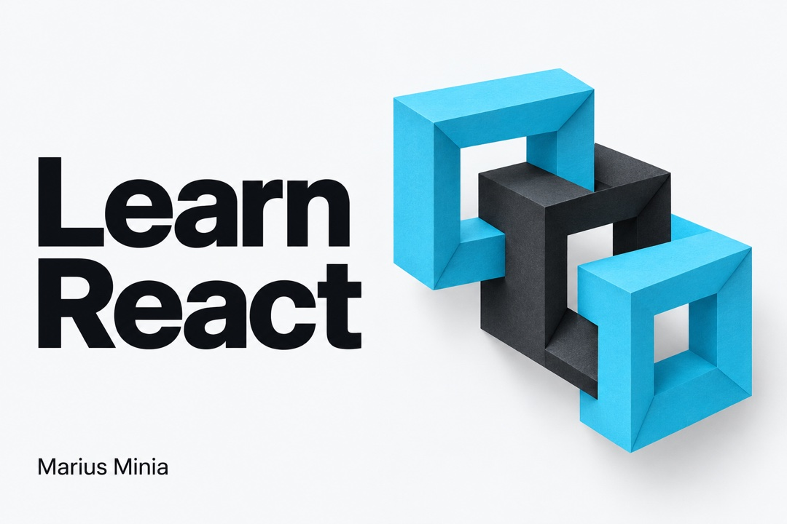
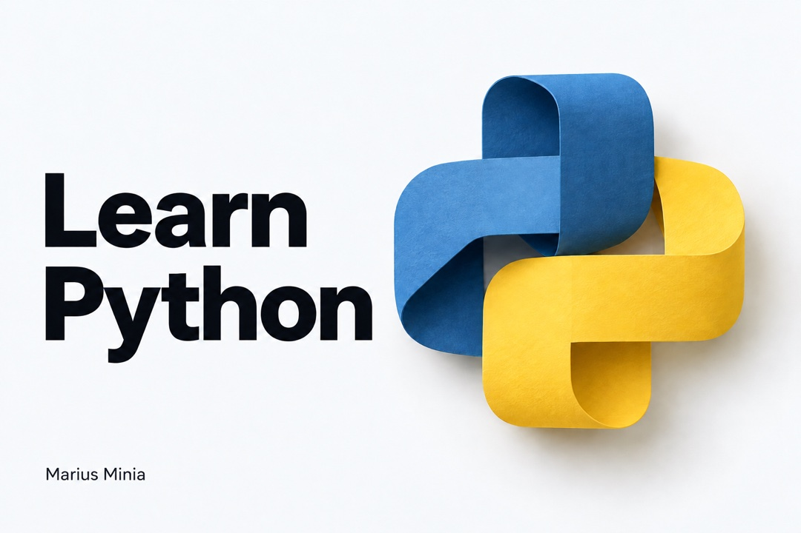
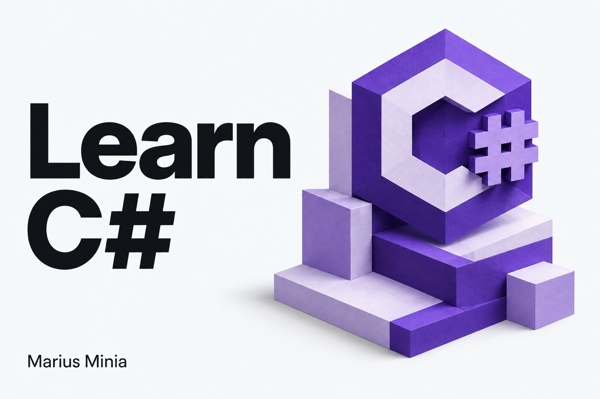

# Marius Minia

### Software Developer · IT Instructor · UX/UI

I build software and teach people how to build it. My work spans full-stack development, software quality and UX/UI, with hands-on courses for developers, students and corporate teams. Apple Developer Academy alumnus.

## Tech stack

**Languages**

            

**Web & markup**

             

**Mobile & platforms**

   

**Databases & data science**

           

**Tooling & infrastructure**

    

**Design**

       

**CMS & productivity**

      

Engineering practices & other skills

**Architecture & development**

            

**Quality & delivery**

         

**Digital marketing**

 

## Contributions

<a href="https://github.com/marius93rm?tab=overview">
  <picture>
    <source media="(prefers-reduced-motion: reduce) and (prefers-color-scheme: dark)" srcset="assets/contributions/snake-static-dark.svg" />
    <source media="(prefers-reduced-motion: reduce)" srcset="assets/contributions/snake-static.svg" />
    <source media="(prefers-color-scheme: dark)" srcset="assets/contributions/snake-dark.svg" />
    
  </picture>
</a>

  <a href="https://github.com/marius93rm?tab=overview">
    <picture>
      <source media="(prefers-color-scheme: dark)" srcset="https://streak-stats.demolab.com?user=marius93rm&amp;theme=dark&amp;background=0D1117&amp;ring=39D353&amp;fire=39D353&amp;currStreakLabel=39D353&amp;stroke=30363D&amp;hide_border=true&amp;disable_animations=true" />
      <source media="(prefers-color-scheme: light)" srcset="https://streak-stats.demolab.com?user=marius93rm&amp;theme=default&amp;ring=238636&amp;fire=238636&amp;currStreakLabel=238636&amp;hide_border=true&amp;disable_animations=true" />
      
    </picture>
  </a>

## Open learning

  

## My website

